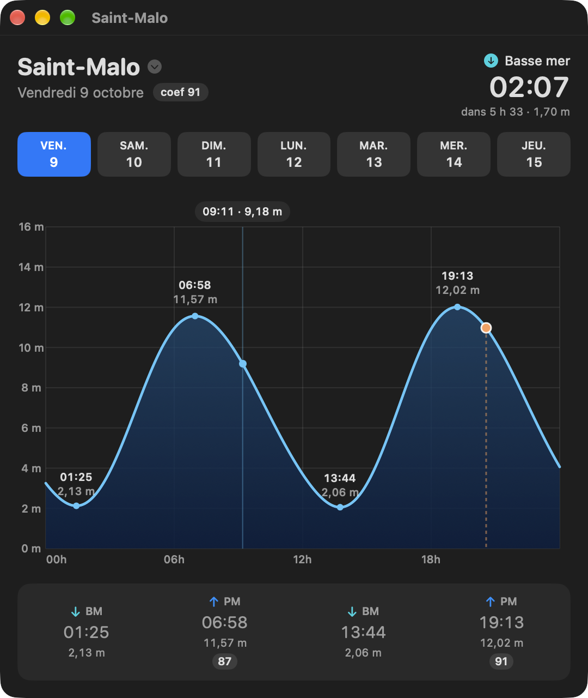
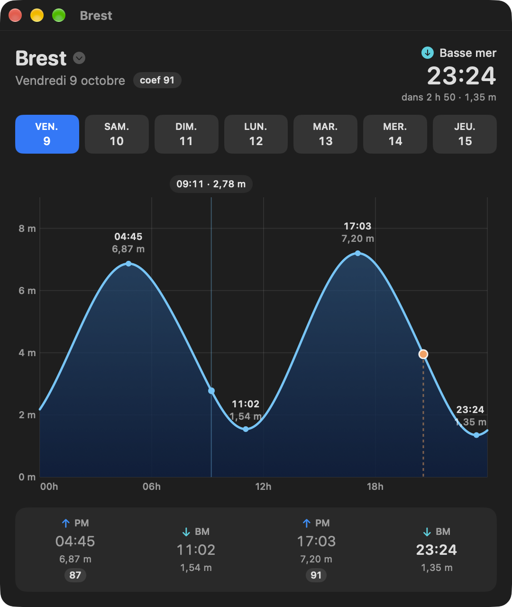
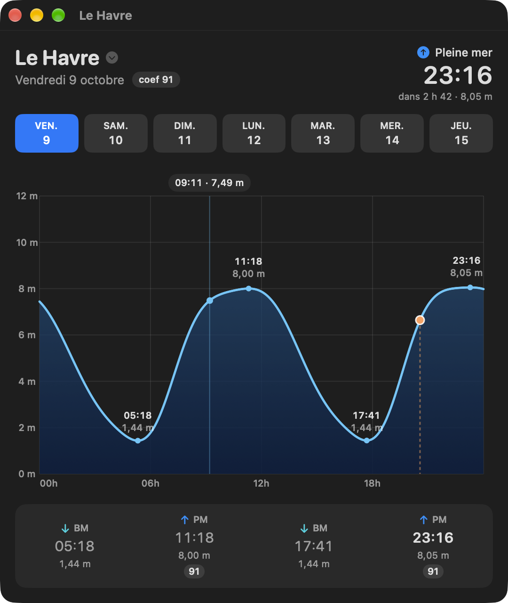

# Marnage

[](https://github.com/gwenn-ha-dev/Marnage/actions/workflows/ci.yml)
[](./LICENSE)


*🇬🇧 [English](./README.md) · 🇫🇷 Français*

Prédiction de marées pour 13 ports français, en Swift pur, **zéro dépendance** (pas de LAPACK, pas de package externe). Le moteur calcule ses propres constantes harmoniques à partir des observations marégraphiques publiques — il ne réutilise aucune prédiction ni constante du SHOM.



## Fonctionnalités

- **Une app macOS** couvrant 13 ports, de Dunkerque à la côte basque : la courbe du jour, les pleines et basses mers avec leurs hauteurs, le coefficient, le compte à rebours jusqu'à la prochaine marée, et la semaine à venir en un clic.
- **Un widget** pour le bureau et le centre de notifications, petit ou moyen, un port par widget.
- **`marnage`**, la ligne de commande : analyse harmonique d'observations brutes, validation sur des données mises de côté, et les marées du jour pour n'importe quel port.
- **`MarnageKit`**, la bibliothèque derrière les deux.
- 33 constituants par défaut ; `--jeu etendu` ajoute 10 ondes composées là où les petits fonds déforment l'onde (Manche Est, Saint-Malo).
- Anglais et français, selon la langue du système.

| Brest | Le Havre |
|---|---|
|  |  |

Le Havre montre pourquoi le moteur calcule ses propres constantes : sa pleine mer tient des heures, ce que reproduisent les constituants d'eaux peu profondes et qu'une simple sinusoïde manquerait.

## Installation

Téléchargez **`Marnage-<version>.dmg`** depuis la [dernière version](https://github.com/gwenn-ha-dev/Marnage/releases/latest), ouvrez-le et glissez Marnage dans Applications. L'app est signée avec un Developer ID et notarisée par Apple : elle s'ouvre d'un double clic.

Lancez-la une fois, puis ajoutez le widget depuis le bureau : clic droit → *Modifier les widgets…* → *Marées*.

Pour la construire depuis les sources :

```sh
git clone https://github.com/gwenn-ha-dev/Marnage.git
cd Marnage
make package      # build/Marnage.app
```

## Utilisation

L'app ne demande rien : choisissez un port dans le menu sur son nom, un jour dans la bande.

La ligne de commande donne les marées d'un jour, à l'heure de Paris :

```sh
$ marnage jour --constantes stations/saint-malo.json --brest stations/brest.json --date 2026-10-09
Saint-Malo — vendredi 9 octobre 2026 (heure de Paris)
  BM 01:25   2.13 m
  PM 06:58  11.57 m   coef  87
  BM 13:44   2.06 m
  PM 19:13  12.02 m   coef  91
```

`--brest` est requis pour tout port autre que Brest : le coefficient de marée est défini à Brest. `marnage` seul liste les commandes (`analyse`, `valide`, `jour`).

## Comment ça marche

1. **Observations** : hauteurs d'eau validées des marégraphes REFMAR, téléchargées depuis `services.data.shom.fr/maregraphie` (données Shom/REFMAR, Licence Ouverte 2.0 Etalab).
2. **Analyse harmonique** : moindres carrés sur 2 ans d'observations, 33 constituants (arguments de Doodson, corrections nodales de Schureman), équations normales résolues par Cholesky.
3. **Prédiction** : somme harmonique, extrema (PM/BM) par recherche ternaire, coefficient de marée calculé à Brest par définition (pic semi-diurne / unité de hauteur 3,05 m).

Le marnage, c'est l'amplitude de la marée — l'écart vertical entre pleine et
basse mer. C'est la grandeur que ce moteur calcule, d'où le nom du projet.

## Construction

| Commande | Ce qu'elle fait |
|---|---|
| `make build` | Compilation release, tout avertissement est une erreur |
| `make test` | Lance la suite de tests |
| `make run` | Lance l'app |
| `make icon` | Régénère `Resources/AppIcon.icns` |
| `make package` | Construit `build/Marnage.app` |
| `make sign` | La signe avec un Developer ID, la notarise et agrafe le ticket |
| `make dmg` | Met l'app notarisée dans un `.dmg` notarisé |
| `make shots` | Refait les captures de `docs/img/` |
| `make release-check` | Vérifie que `build/` est publiable |
| `make lint` | Vérifie la conformité à la charte |
| `make help` | Liste toutes les cibles |

## Dépendances

Aucune — frameworks Apple uniquement.

## Licence

MIT © 2026 gwenn-ha-dev — voir [LICENSE](./LICENSE). Observations marégraphiques : Shom/REFMAR, Licence Ouverte 2.0 Etalab.
