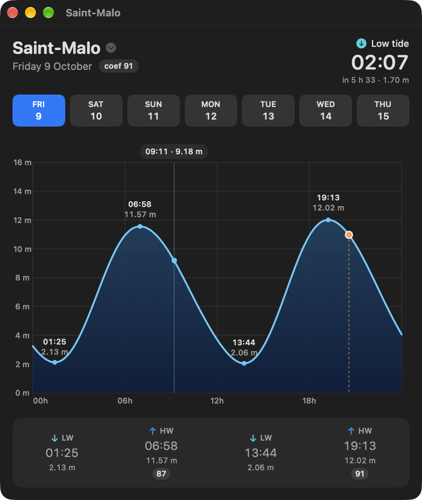
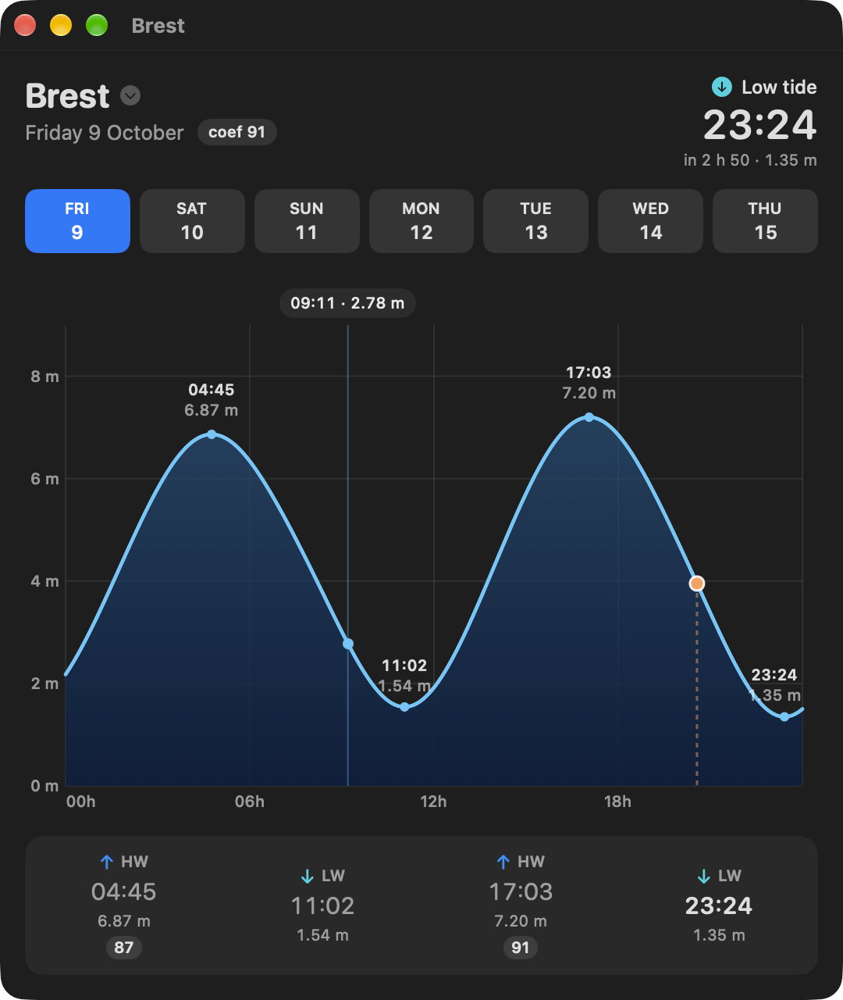
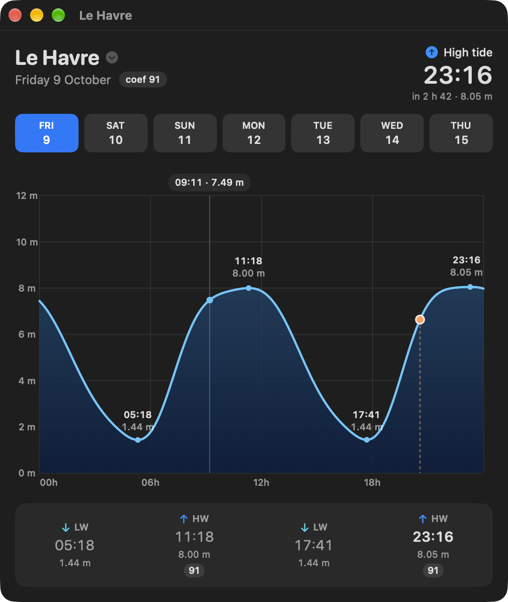

# Marnage

[](https://github.com/gwenn-ha-dev/Marnage/actions/workflows/ci.yml)
[](./LICENSE)


*🇬🇧 English · 🇫🇷 [Français](./README.fr.md)*

Tide prediction for 13 French ports, in pure Swift, **zero dependencies** (no LAPACK, no external package). The engine computes its own harmonic constants from public tide-gauge observations — it reuses no SHOM prediction and no SHOM constant.



## Features

- **A macOS app** covering 13 ports from Dunkirk to the Basque coast: the day's curve, high and low waters with their heights, the tide coefficient, a countdown to the next tide, and a week ahead one click away.
- **A widget** for the desktop and Notification Center, small or medium, one port per widget.
- **`marnage`**, the command line: harmonic analysis of raw observations, validation against held-out data, and the day's tides for any port.
- **`MarnageKit`**, the library behind both.
- 33 constituents by default; `--jeu etendu` adds 10 compound waves where shallow water distorts the tide (eastern Channel, Saint-Malo).
- English and French, following the system language.

| Brest | Le Havre |
|---|---|
|  |  |

Le Havre shows why the engine computes its own constants: its high water stands still for hours, which the shallow-water constituents reproduce and a plain sine would not.

## Install

Download **`Marnage-<version>.dmg`** from the [latest release](https://github.com/gwenn-ha-dev/Marnage/releases/latest), open it and drag Marnage onto Applications. The app is signed with a Developer ID and notarized by Apple: it opens with a double click.

Launch it once, then add the widget from the desktop: right-click → *Edit Widgets…* → *Tides*.

To build from source instead:

```sh
git clone https://github.com/gwenn-ha-dev/Marnage.git
cd Marnage
make package      # build/Marnage.app
```

## Usage

The app needs nothing: pick a port from the menu on its name, a day from the strip.

The command line prints a day's tides, in Paris time:

```sh
$ marnage jour --constantes stations/saint-malo.json --brest stations/brest.json --date 2026-10-09
Saint-Malo — vendredi 9 octobre 2026 (heure de Paris)
  BM 01:25   2.13 m
  PM 06:58  11.57 m   coef  87
  BM 13:44   2.06 m
  PM 19:13  12.02 m   coef  91
```

`--brest` is needed for any port other than Brest: the tide coefficient is defined at Brest. `marnage` alone lists the commands (`analyse`, `valide`, `jour`).

## How it works

1. **Observations**: validated water heights from REFMAR tide gauges, downloaded from `services.data.shom.fr/maregraphie` (Shom/REFMAR data, Etalab Open Licence 2.0).
2. **Harmonic analysis**: least squares over 2 years of observations, 33 constituents (Doodson arguments, Schureman nodal corrections), normal equations solved by Cholesky.
3. **Prediction**: harmonic sum, extrema found by ternary search, tide coefficient computed at Brest by definition (semi-diurnal peak / 3.05 m height unit).

The *marnage* is the tidal range — the vertical distance between high and low
water. It is the quantity this engine computes, so it is what the project is called.

## Build

| Command | What it does |
|---|---|
| `make build` | Release build, warnings are errors |
| `make test` | Run the test suite |
| `make run` | Launch the app |
| `make icon` | Regenerate `Resources/AppIcon.icns` |
| `make package` | Build `build/Marnage.app` |
| `make sign` | Sign it with a Developer ID, notarize and staple it |
| `make dmg` | Pack the notarized app into a notarized `.dmg` |
| `make shots` | Retake the captures in `docs/img/` |
| `make release-check` | Check that `build/` is publishable |
| `make lint` | Check compliance with the project charter |
| `make help` | List every target |

## Dependencies

None — Apple frameworks only.

## License

MIT © 2026 gwenn-ha-dev — see [LICENSE](./LICENSE). Tide-gauge observations: Shom/REFMAR, Etalab Open Licence 2.0.
